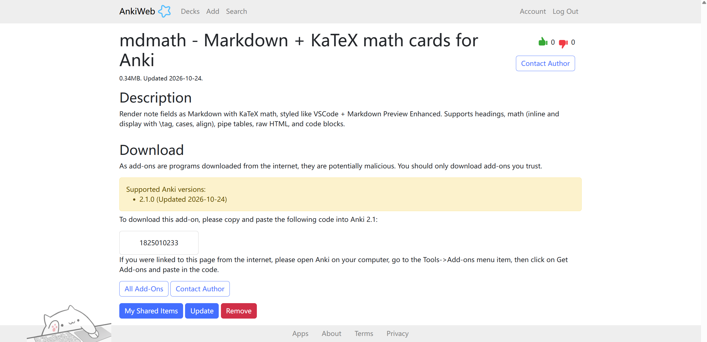

# 我的自研 anki 插件

## 什么是 Anki

Anki 是一个免费的 "记忆卡片" 软件 (开源, 跨平台, 桌面, 安卓, 苹果都能装). 用法很简单: 一张卡片, 正面一个问题, 背面一个答案. Anki 按**间隔重复**的方式安排复习——它会盯着你每张卡的掌握程度, 在你快忘的时候提醒你再过一遍, 记牢了就把复习间隔拉长.

所以它特别适合需要"记住"的东西: 背单词, 背定义, 背定理, 背公式. 学数学的人拿它背知识点, 很常用. Anki 官方有个插件商店, 可以装各种插件扩展功能.

## 现有插件的诟病

可惜, **Anki 默认不认 Markdown, 卡片里的公式显示也一般**. 要么公式丑, 要么得手动转成 Anki 的标签, 麻烦.

为此, 我自行开发了 **mdmath** 插件.

**mdmath** 就是干这个的: 让你的 Anki 卡片直接渲染 Markdown 和 LaTeX 公式, 效果和你在 VSCode + Markdown Preview Enhanced (MPE) 里看到的一致.

{width=100%}

## mdmath 支持什么

- Markdown 基础语法: 标题, 加粗, 引用, 列表, 分割线;
- 行内 `$...$` 和行间 `$$...$$` 公式 (含 `\tag` 编号, `\begin{cases}`, `\begin{bmatrix}`, `\begin{align}`) , 用的是和 MPE 同款的 KaTeX 引擎;
- 管道表格 (单元格里也能放公式) ;
- 行内 HTML (` `, `< div align=center> `) ;
- 代码块.

## 效果举例

比如我泛函作业里的这道题, 正面贴题目, 背面贴解答:

> **正面**: 设 $\left(X,d\right)$ 是度量空间, 证明 $d'\left(x,y\right)=\frac{d\left(x,y\right)}{1+d\left(x,y\right)}$ 也是 $X$ 上的度量.

> **背面**: 记 $\varphi\left(t\right)=\frac{t}{1+t}$, 逐条验证 (i)(ii)(iii)…… (完整证明)

在 mdmath 里, 把上面的 Markdown 原文原样贴进 `Front` / `Back` 字段就行, 卡片会自动渲染成公式.

## 怎么装

**没装过 Anki？** 先去 https://apps.ankiweb.net/ 下载安装 (一路默认即可) , 装完打开.

接着装插件, 有两个渠道, 任选其一:

**渠道一: AnkiWeb (推荐, 最省事)** —— 打开插件页 https://ankiweb.net/shared/info/1825010233 , 点 **Download** 下载 `mdmath.ankiaddon`, 回到 Anki 用 **工具 → 插件 → 从文件安装** 选中即可; 也可以在 Anki 里 **工具 → 插件 → 获取插件** 搜索 `mdmath` 直接装.

**渠道二: GitHub (开源仓库)** —— 打开发布页 https://github.com/wenje-ma/anki-mdmath/releases/tag/v0.1.0 , 点 **mdmath.ankiaddon** 直接下载; 想看源码 / 提建议的同学, 去 https://github.com/wenje-ma/anki-mdmath .

装完重启 Anki. 插件会自动创建一个 `mdmath` 笔记类型, 正面 `Front`, 背面 `Back` 两个字段, 开箱即用.

## 怎么用

1. 新建笔记, 笔记类型选 `mdmath`;
2. **Front** 字段贴题目的 Markdown 原文, **Back** 字段贴解答的 Markdown 原文 (标题, 公式原样放进去即可) ;
3. 点添加, 复习时卡片自动渲染成 Markdown + LaTeX 排版.

> 正面放题目, 背面放解答, 就是标准的"先看题, 再对答案", 正好对应作业里 `##` 题目, `###` 解答的结构.

## 想调整样式?

打开 **工具 → 插件 → mdmath → 配置**, 可以改字号, 字体, 行距, 文字/背景色, 页边距 (电脑和手机可以分别设置).

## 其他

- 卡片渲染是纯前端 JS 做的, 同步到安卓 / iOS 的 Anki 后公式也能正常显示.
- 插件基于 MIT 协议开源, 内置的 KaTeX 和 marked 也都是 MIT 协议.
- 有任何问题或想加的功能, 欢迎留言告诉我.
