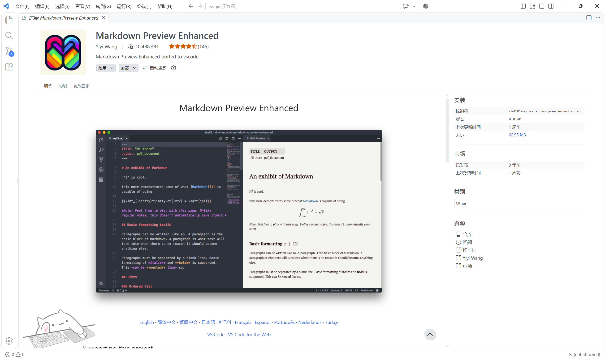
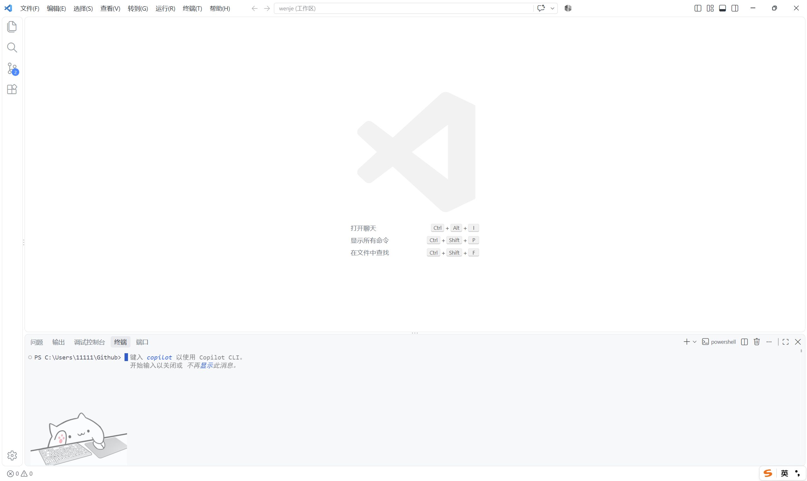

# 一命速通: 查阅习题集

## 我的仓库

### 我的 GitHub 主页

1. 打开你电脑上的浏览器（Chrome、Edge 都行）。
2. 在**地址栏**（浏览器最上方输网址的地方）输入 `https://github.com/wenje-ma`，按回车。
3. 你应该能看到我的个人主页：


页面上能看到我的 Overview、Repositories、Stars 等。右上角可以搜索，也可以直接点 `Repositories` 查看全部公开仓库。

### 我的收藏（Stars）

在地址栏输入 `https://github.com/wenje-ma?tab=stars`，按回车，打开我的 `Stars`，其中名为 `basic` 的 list 就是数学基础学科仓库集：


点开任意一个学科仓库（例如拓扑学 `topology`），里面一般有：

- `cn` 文件夹 — 中文笔记，核心文件是 `notes.md`;
- `homework` 文件夹 — 习题集。

以拓扑学为例，打开后的页面大致如下：


点进 `cn` 文件夹，再点 `notes.md`，就能在网页上直接看笔记了（不过网页端渲染效果一般，想获得最佳阅读体验，请看下面的"安装 vscode 与 MPE 插件"一节）。

---

## 安装 vscode 与 MPE 插件

### 安装 vscode

1. 打开 `https://code.visualstudio.com/`。
2. 点页面中间的 **Download for Windows**（macOS 会自动显示 macOS 版，照页面提示下载即可）。
3. 下载完成后**双击安装包**，一路点 **下一步/Next**（保持默认设置即可）。
4. 安装完成，打开 vscode，出现欢迎页/开始界面就说明装好了。

### 安装 MPE 插件

1. 打开 `vscode`，点左侧竖排图标里的 **扩展**（四方块那个，快捷键 `Ctrl+Shift+X`）。
2. 在搜索框输入 `Markdown Preview Enhanced`（简称 MPE）。
3. 点 **Install** 安装，装完如果提示"重新加载/Reload"，点一下。
4. 装好之后，扩展页面会变成 **禁用/卸载/自动更新** 三个按钮（见下图），就说明安装成功：



装好后，打开任何一个 `.md` 文件，右上角会出现预览按钮，点击即可看到排版好的渲染效果。我的笔记都是 `markdown` 写的，用它能获得最好的阅读体验。

---

## 安装 `git`

`git` 是"克隆"这条命令的引擎，必须先装好。**安装过程中任何看不懂的选项，都保持默认，直接点下一步即可。**

### Windows

1. 打开官网 `https://git-scm.com/download/win`，下载 Windows 版安装包。
2. 双击运行安装包，一路点 **Next**（保持默认设置即可）。
3. 安装完成后，**重新打开**一个终端（重要），输入 `git --version` 能看到版本号，就说明装好了。

> 小技巧：`git` 装好后会自带一个 `Git Bash`（类似 Linux 的终端），初学者用它最省心，下面统一用它演示。

### macOS

打开 `https://git-scm.com/download/mac`，下载 macOS 版安装包（`.pkg` 文件），双击安装，一路"继续"即可。

**会用 Homebrew 的话**，打开"终端"（`Cmd + 空格` 搜 Terminal）输入：

```bash
brew install git
```

### Linux（Debian/Ubuntu 系）

```bash
sudo apt update && sudo apt install -y git
```

### 装完统一验证

```bash
git --version
```

只要输出了类似 `git version 2.x.x` 的字样，就代表安装成功。

**没看到版本号?** 如果提示"不是内部或外部命令" / `command not found`，说明没装好，或者终端是安装前打开的。重新打开一个终端再试一次；还不行就回到上面重装。

---

## 打开终端

克隆会把仓库下载到**当前所在目录**，所以先想好放哪（建议专门建一个文件夹，比如 `Github`），再让终端"定位"到那里。下面用最不容易出错的方式：

1. 在桌面新建一个文件夹，命名为 `Github`（名字随意，别用中文就行）。
2. 打开 `vscode`，点左上角 **文件 → 打开文件夹**，选中刚才的 `Github` 文件夹。
3. 按 `Ctrl + J`（macOS 是 `Cmd + J`）打开底部终端面板。
4. 终端里会出现类似 `PS C:\Users\11111\Github>` 的提示符，说明已经定位好了（见下图）：



> 不确定定位对不对？在终端里输入 `pwd` 回车，看输出的路径是不是你的文件夹。

> 更习惯 Git Bash？在文件夹**空白处右键** → **Open Git Bash here**，弹出的窗口就是定位好的终端，效果一样。

---

## 开始克隆

在终端里输入下面这条命令，然后回车：

```bash
git clone https://github.com/wenje-ma/topology
```

正常情况会输出：

```bash
Cloning into 'topology'...
remote: Enumerating objects: 512, done.
remote: Counting objects: 100% (512/512), done.
remote: Compressing objects: 100% (394/394), done.
remote: Total 512 (delta 245), reused 383 (delta 116), pack-reused 0 (from 0)
Receiving objects: 100% (512/512), 2.02 MiB | 1.31 MiB/s, done.
Resolving deltas: 100% (245/245), done.
```

看到 `done.` 就成功了。回到 vscode，左侧文件树里应该出现 `topology` 文件夹，点开就能看到 `cn` 和 `homework`。

**想克隆其他学科仓库？** 把命令里的 `topology` 换成任意仓库名即可：

```bash
git clone https://github.com/wenje-ma/<仓库名>
```

### 克隆失败了?

| 终端里的报错（关键词） | 原因 | 怎么办 |
|---|---|---|
| `unable to access` / `Could not resolve host` / 一直转圈 | 网络连接问题 | 检查网络环境，***校园网用户可咨询学校提供的网络与学术访问服务*** |
| `destination path ... already exists` | 这个文件夹之前已经克隆过了 | 不用管，直接去用现有的；或换个目录重新克隆 |
| `Permission denied (publickey)` | 不小心用了 SSH 地址 | 换成 `https://github.com/wenje-ma/仓库名` 这种地址即可 |
| `不是内部或外部命令` / `command not found` | git 没装好 | 回到"安装 git"重装，装完**重新打开**终端 |

---

## 仓库更新了怎么办

我可能会更新笔记。想同步到最新，**不用重新克隆**：

1. 用 vscode 打开克隆下来的 `topology` 文件夹。
2. 按 `Ctrl + J` 打开终端（或在该文件夹空白处右键 Git Bash）。
3. 运行：

```bash
git pull
```

看到 `Already up to date.` 说明已是最新；看到 `Updating ...` 并自动跑完，说明更新成功。

---

## 进阶：不用背网址

`git clone` 什么都好，唯一的小缺点是要敲一长串网址。GitHub 官方出品的命令行工具 **`gh`（GitHub CLI）**，能让你只写 `所有者/仓库名` 就够了。

### 安装 gh

打开 `https://cli.github.com/`，按你的系统下载安装（Windows 下载 `.msi` 安装包，双击一路下一步即可），装完在终端验证：

```bash
gh --version
```

### 登录一次

克隆前要先登录（只需要做这一次）：

```bash
gh auth login
```

按提示操作（只需回车和选数字）：
1. 问 `What account do you want to use?` → 选 `GitHub.com`，回车；
2. 问 `What protocol do you want to use?` → 选 `HTTPS`（默认就是它），回车；
3. 问 `Authenticate Git with your GitHub credentials?` → 选 `Yes`，回车；
4. 问 `How would you like to authenticate?` → 选 `Login with a web browser`，回车；
5. 浏览器会自动弹出页面，点 **Authorize** 授权；
6. 回到终端，看到 `Logged in as wenje-ma` 就成功了。

### 开始使用

以后克隆仓库，只需：

```bash
gh repo clone wenje-ma/topology
```

注意写法是 **`所有者/仓库名`**（没有网址）。想克隆别的学科，把 `topology` 换掉即可：

```bash
gh repo clone wenje-ma/<仓库名>
```

### 和 `git clone` 的区别

**没有本质区别**。`gh` 底层调用的还是 `git`，只是帮你拼好了网址。你可以理解为：`gh repo clone` 是"不用背网址版的 `git clone`"。选你觉得顺手的那个即可。

---

祝同志们学习顺利，Happy mathing! 🚀
