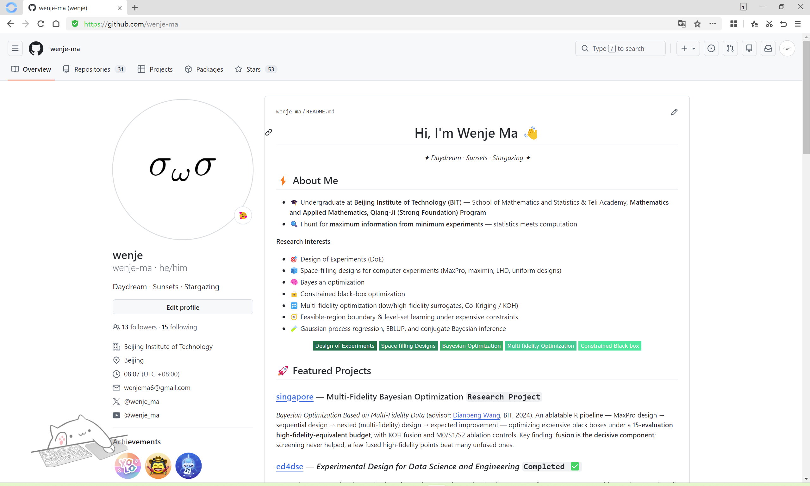
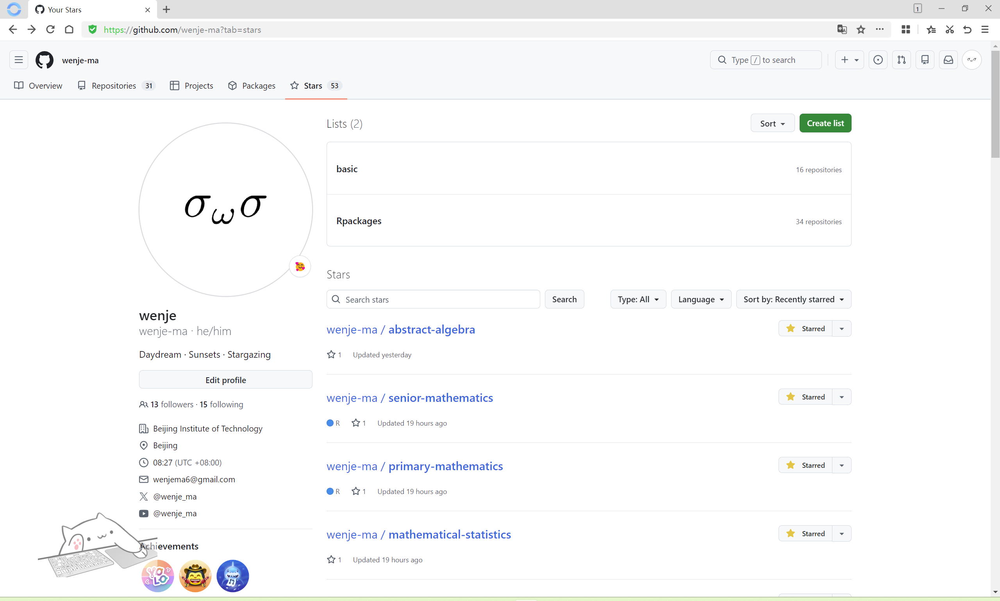
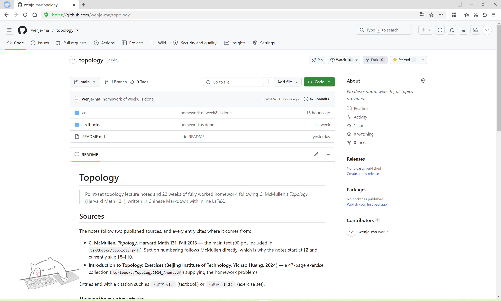

# 无痛 GitHub 教学

---

## 我的仓库

### 我的 GitHub 主页

点击[此网址](https://github.com/wenje-ma)打开我的个人主页:



页面上能看到我的 Overciew, Repositories, Stars 等. 右上角可以搜索, 也可以直接点 `Repositories` 查看全部公开仓库.

### 我的收藏 (Stars)

点击[此网址](https://github.com/wenje-ma?tab=stars)打开我的 `Stars`, 其中名为 `basic` 的 list 就是数学基础学科仓库集:



里面一般有:

- `cn` 文件夹 —— 公众号里发布的**中文笔记**, 核心文件是 `notes.md`;
- `homework` 文件夹 —— 习题集.

以拓扑学为例, 打开后的页面大致如下:



---

## 如何访问 GitHub

这是很多人卡住的第一步. GitHub 在国内直连不稳定, 分两种情况:

### 在北京理工大学校园网内

在校园网 (北京理工大学) 环境中, 访问[此网址](https://scholar.edu.cn/), 在页面右上角点击 **浏览器及工具下载**, 选择相应版本的浏览器下载并安装即可. 我选择的是 `Open Browser`.

在桌面上双击该图标, 打开效果形如:


点击 **推荐站点** 中的 `GitHub`, 即可无需魔法, 无痛登录！

> ⚠️ 注意: `Open Browser` 解决的是**浏览器**访问 GitHub. 后面我们要在**终端**里运行 `git clone`, 终端是直连 `github.com` 的, 走的通道和浏览器不一定相同. 因此有需求的同志们还需安装该网站下方的 **学术工具**, 然后跟着安装指引走即可.

### 在北京理工大学校园网之外

老老实实挂梯子吧 😭😭😭. 

> ⚠️ 注意: 若要在**终端**里运行 `git clone`, 终端是直连 `github.com` 的, 走的通道和浏览器不一定相同. 因此建议直接打开**虚拟网卡**模式, 一劳永逸.

---

## 安装 `git`

### Windows

1. 打开官网 <https://git-scm.com/download/win>, 下载 Windows 版安装包.
2. 双击运行安装包, 一路点 **Next** (保持默认设置即可) .
3. 安装完成后, **重新打开**一个终端 (重要) , 输入 `git --version` 能看到版本号, 就说明装好了.

> 小技巧: `git` 装好后会自带一个 `Git Bash` (类似 Linux 的终端) , 初学者用它最省心, 下面统一用它演示.

### macOS

打开"终端" (`Cmd + 空格` 搜 Terminal) , 粘贴下面任意一条回车 (装了 [Homebrew](https://brew.sh/) 用第一条, 否则看第二条) :

```bash
brew install git
```

```bash
git --version   # 如果系统自带, 直接会显示版本号
```

### Linux (Debian/Ubuntu 系)

```bash
sudo apt update && sudo apt install -y git
```

装完统一验证:

```bash
git --version
```

只要输出了类似 `git version 2.x.x` 的字样, 就代表安装成功.

---

## 安装 `vscode` 与 MPE 插件

### 安装 vscode

打开 <https://code.visualstudio.com/>, 下载并安装 (保持默认设置即可) .

### 安装 MPE 插件 (强烈推荐)

1. 打开 `vscode`, 点左侧竖排图标里的 **扩展** (四方块那个, 快捷键 `Ctrl+Shift+X`) .
2. 搜索 `Markdown Preview Enhanced` (简称 MPE) .
3. 点 **Install** 安装.

装好后, 打开任何一个 `.md` 文件, 右上角会出现预览按钮, 点击即可看到排版好的渲染效果. 我的笔记都是 `markdown` 写的, 用它能获得最好的阅读体验.

---

## 打开终端, 并定位到你想要的位置

克隆会把仓库下载到"当前所在目录". 先想好放哪里 (比如 `桌面` 或 `D:\我的资料`) , 然后打开终端并**进入那个目录**.

打开 vscode, 打开一个你希望把仓库放进去的文件夹, 然后按 `ctrl (cmd) + J` 打开终端.

---

## 开始克隆

在终端里输入下面这条命令, 然后回车:

```bash
git clone https://github.com/wenje-ma/topology
```

正常情况会输出类似:

```
Cloning into 'topology'...
remote: Enumerating objects: ...
Receiving objects: ...
Resolving deltas: ...
```

最后没有报错, 就成功了.

想克隆其他学科仓库? 把命令里的 `topology` 换成任意仓库名即可:

```bash
git clone https://github.com/wenje-ma/<仓库名>
```

---

## 仓库更新了怎么办

我可能会更新笔记. 想同步到最新, **不用重新克隆**, 在克隆下来的 `topology` 文件夹里打开终端, 运行:

```bash
git pull
```

---

## 进阶: 不用背网址

`git clone` 什么都好, 唯一的小缺点是要敲一长串网址. GitHub 官方出品的命令行工具 **`gh` (GitHub CLI)**, 能让你只写 `所有者/仓库名` 就够了.

### 安装 gh

打开 <https://cli.github.com/>, 按你的系统下载安装, 装完在终端验证:

```bash
gh --version
```

### 登录一次

克隆前要先登录 (只需要做这一次) :

```bash
gh auth login
```

按提示操作即可.

### 开始使用

以后克隆仓库, 只需:

```bash
gh repo clone wenje-ma/topology
```

注意写法是 **`所有者/仓库名`** (没有网址) . 想克隆别的学科, 把 `topology` 换掉即可:

```bash
gh repo clone wenje-ma/<仓库名>
```

### 和 `git clone` 的区别

**没有本质区别**.  `gh` 底层调用的还是 `git`, 只是帮你拼好了网址. 你可以理解为: `gh repo clone` 是"不用背网址版的 `git clone`". 选你觉得顺手的那个即可.

---

祝同志们学习顺利, Happy mathing! 🚀
